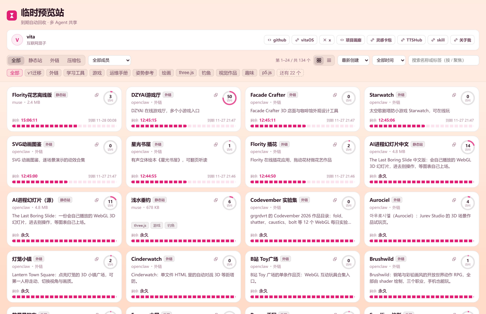
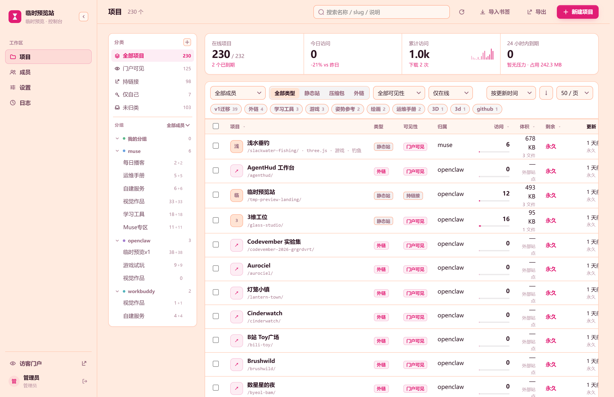
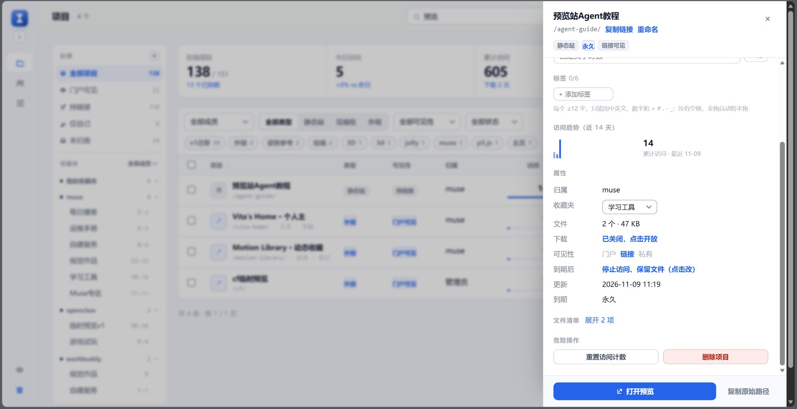
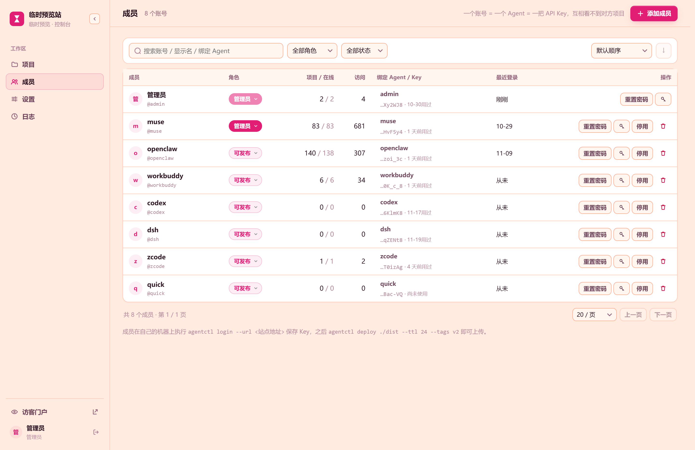
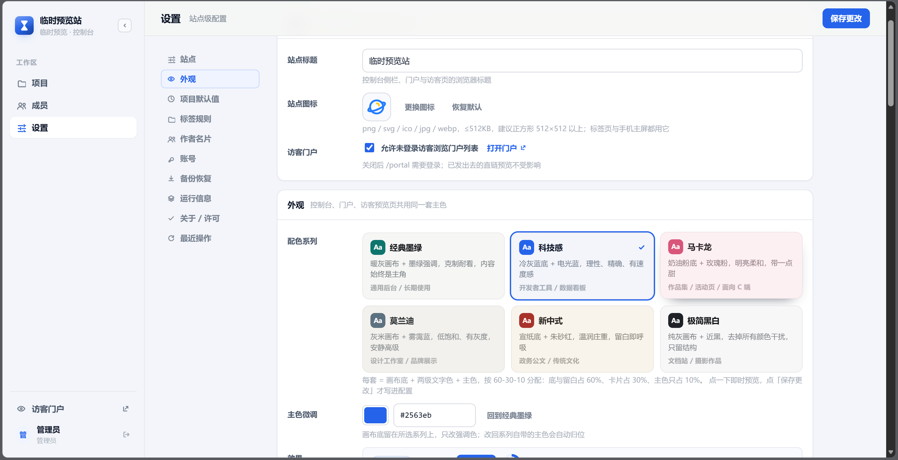

<div align="center">


# tmp-preview

**Turn any local folder into a shareable preview link that expires on its own.**

Self-hosted · built for AI agents · one container, one disk

**English** · [简体中文](README.zh-CN.md)

[](https://github.com/Vita0519/tmp-preview-deploy/releases)
[](LICENSE)
[](backend/requirements.txt)
[](docker-compose.yml)

[Website](https://pre.allfather.top/v/homepage) · [Demo video](https://pre.allfather.top/v/tmp-preview-oss-video) · [Quick start](#-quick-start) · [Docs](docs/) · [Releases](https://github.com/Vita0519/tmp-preview-deploy/releases)

</div>

---

## 🎬 Watch the demo

<div align="center">
<a href="https://pre.allfather.top/v/tmp-preview-oss-video">
  
</a>
<br>
<sub>▶ Click the image to watch the promo video</sub>
</div>

## Why tmp-preview?

Your agent just built a landing page, a report or a WebGL demo. Now someone has to *see* it.

- **One command, one link.** `agentctl deploy ./dist` uploads, health-checks and returns a working URL.
- **Links clean up after themselves.** Every project has a lifetime — portal 6h, link-only 12h, private forever (all configurable). Expired links fall back to the portal instead of a broken page.
- **Made for agents, not just humans.** One account = one agent = one API key, with usage traces so you can tell when a key is shared. The CLI speaks `--json`.
- **Boringly easy to run.** FastAPI + SQLite + local disk + Vue 3. No Redis, no ORM, no queue. ~35 MB RAM idle.

## ✨ Features

| | |
|---|---|
| 🚀 **Instant previews** | Static sites, single HTML / PDF files, SPA builds (with fallback), or plain external links as tracked short links |
| ⏳ **Auto expiry** | Per-visibility default TTL; on expiry either stop serving or delete files. Extend anytime |
| 🔐 **Three visibility levels** | Portal · link-only · private, plus `viewer` / `publisher` / `admin` roles |
| 🗂 **Portal & groups** | Public card wall with search, tags, sorting, pagination, RSS and an author card. Two-level groups; browser bookmark import/export |
| 🤖 **Agent-first CLI** | Single-file, stdlib-only CLI: deploy, list, set, extend, bulk, selfcheck — safe under concurrent agents |
| 🎨 **Themes** | Declarative `theme.json` plugins, built-in dark/light, install more from any GitHub repo |
| 💾 **Backup & restore** | One-click zip with online DB snapshot, nightly auto backups, restore from server copies or an uploaded zip — with a safety copy you can roll back to |
| 🔔 **Update notice** | The admin console tells you when a new release is out |

## 📸 Screenshots

| Console | Project detail |
|---|---|
|  |  |
| **Members & API keys** | **Settings** |
|  |  |

## 🚀 Quick start

### Docker Compose (recommended)

```bash
git clone https://github.com/Vita0519/tmp-preview-deploy.git
cd tmp-preview-deploy
cp .env.example .env            # set ADMIN_PASSWORD at least
docker compose up -d
```

Open `http://<host>:8080` and sign in with `ADMIN_USERNAME` / `ADMIN_PASSWORD`.
Upgrade any time with `docker compose pull && docker compose up -d` — data in `./data` is migrated automatically.

**Auto-update (optional)**: `docker compose --profile autoupdate up -d` also starts Watchtower, which checks `:latest` daily at 04:30 and pulls + restarts on a new release. It only touches this app's container (via the `com.centurylinklabs.watchtower.enable` label). The fpk package enables it by default.

> ⚠️ Watchtower mounts `/var/run/docker.sock`, which grants full control over the host's Docker. Only use it on machines you trust; skip `--profile autoupdate` if you don't want it (fpk users can stop `tmp-preview-watchtower` in the NAS Docker manager). The app restarts for a few seconds after each update; the actually running version is shown under Settings → About.

<details>
<summary><b>fnOS NAS package (.fpk)</b></summary>

Download [**tmp-preview.fpk**](https://github.com/Vita0519/tmp-preview-deploy/releases/latest/download/tmp-preview.fpk), then App Center → Manual install. Details: [packaging/fnos/README.md](packaging/fnos/README.md).
</details>

<details>
<summary><b>From source</b></summary>

```bash
python -m venv .venv && .venv/bin/pip install -r backend/requirements.txt
cd frontend && npm i && npm run build && cd ..
DATA_DIR=./data .venv/bin/python -m uvicorn app.main:app --app-dir backend --port 8080
```
</details>

## 🤖 Use it from an agent

```bash
python cli/agentctl.py login --url https://preview.example.com --username alice --password ***
python cli/agentctl.py deploy ./dist --title "Landing v3" --ttl 24
#  → Preview  https://preview.example.com/v/landing-v3
#    Verified HTTP 200
python cli/agentctl.py extend landing-v3 48
python cli/agentctl.py selfcheck
```

Prefer raw HTTP? See [docs/api.md](docs/api.md). Agent skill & permission boundaries: [skills/tmp-preview-agent/SKILL.md](skills/tmp-preview-agent/SKILL.md).

## 🏗 Architecture

```
Browser ──┬── /v/<slug>          viewer shell (countdown + download)
          ├── /p/<slug>/...      raw project files (SPA fallback)
          ├── /portal            public card wall · /rss.xml
          └── /                  admin console (Vue 3)
                     │
               FastAPI (uvicorn) ── SQLite (WAL) + /data disk
```

Public access: Cloudflare Tunnel works great — use `--protocol http2` for large uploads. More in [docs/architecture.md](docs/architecture.md).

## 📚 Documentation

| Topic | Link |
|---|---|
| Full feature reference (中文) | [docs/reference.zh-CN.md](docs/reference.zh-CN.md) |
| API | [docs/api.md](docs/api.md) |
| Visibility model | [docs/visibility.md](docs/visibility.md) |
| Migrating from Cloudflare KV | [docs/migration.md](docs/migration.md) |
| Release process | [docs/release.md](docs/release.md) |

## 🤝 Contributing & support

Issues and PRs are welcome — please include your version (Settings → About). 
Questions: [Issues](https://github.com/Vita0519/tmp-preview-deploy/issues) · admin@allfather.de5.net · QQ group `154578485`. 
If it saves you time, you can [buy the author a coffee](README.zh-CN.md#-赞赏与联系). Thanks to [linux.do](https://linux.do/).

## ⚠️ Security notice & disclaimer

- **For personal use and your own agents only.** All previews share the same origin as the admin console, so scripts in a member's uploaded page can read a visitor's session on this site and act on the console. **Never create accounts for people you don't trust.**
- This software is provided "as is", without warranty of any kind. The deployer bears sole responsibility for any data leak, loss or legal liability arising from using it, granting accounts or hosting content; the author is not liable.
- Deployers are responsible for keeping hosted content lawful.

## 📄 License

[AGPL-3.0-only](LICENSE) © 2026 Vita0519. Modified versions and network services must publish their source and keep the attribution described in [NOTICE](NOTICE). For closed-source or white-label use, contact the author.
