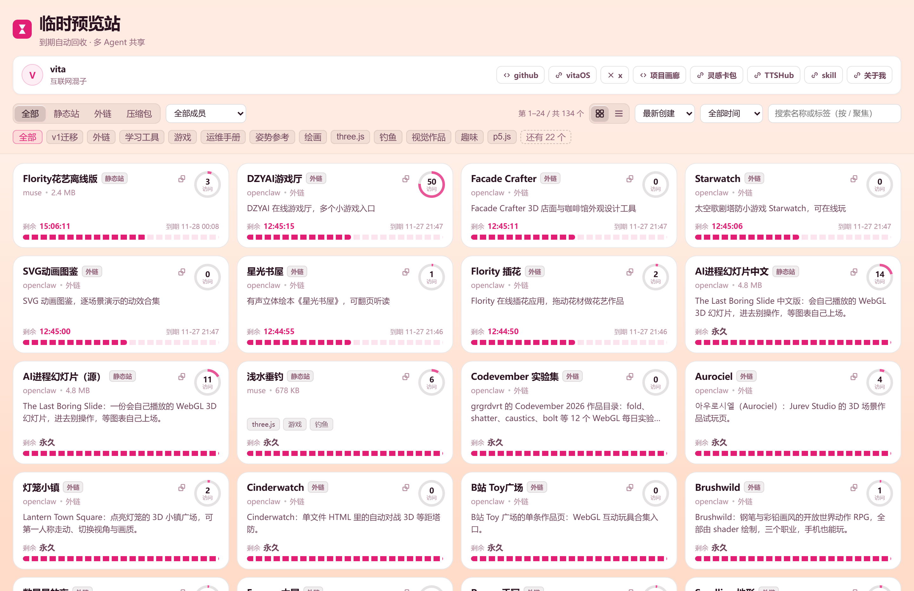
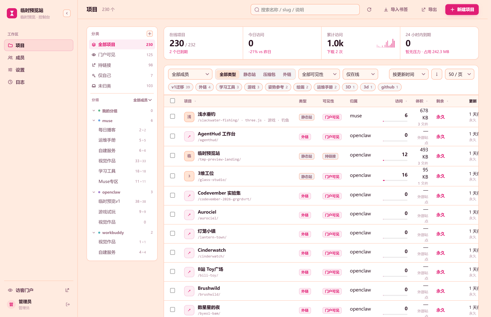
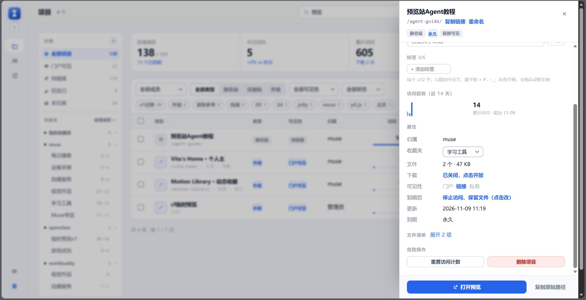
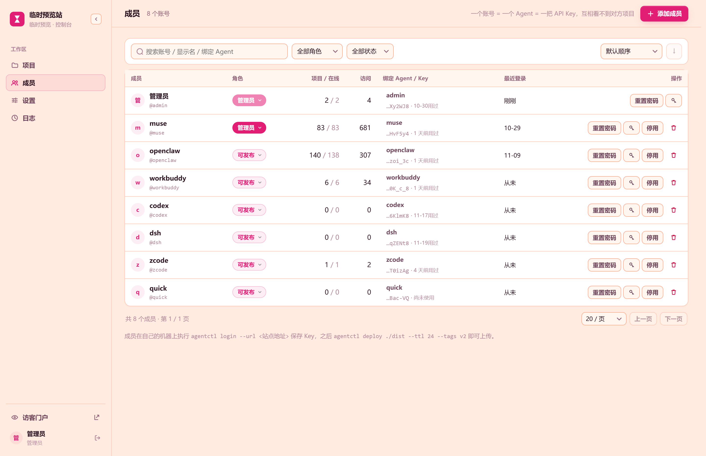
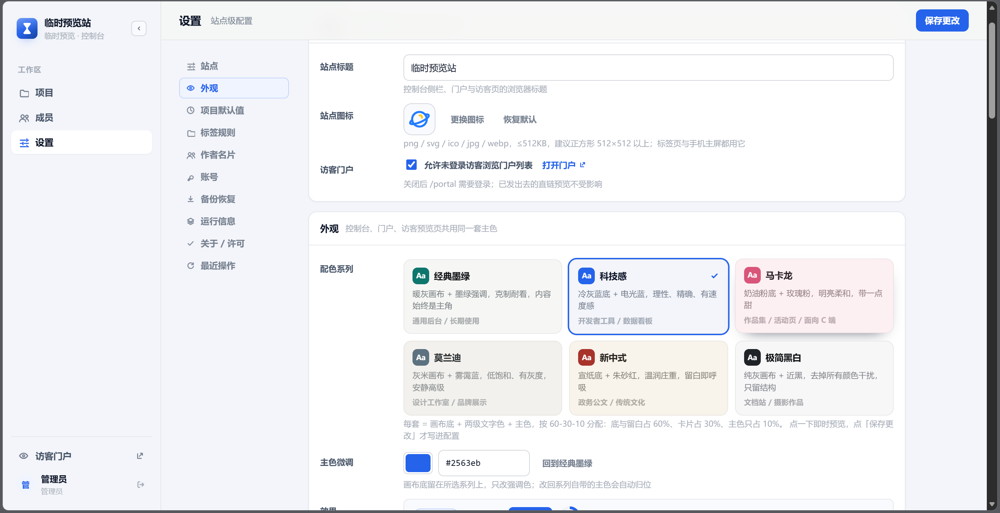

<div align="center">


# tmp-preview · 临时预览站

**把任意本地目录一键变成带到期时间的预览链接。**

自托管 · 为 AI Agent 设计 · 一个容器一块盘

[English](README.md) · **简体中文**

[](https://github.com/Vita0519/tmp-preview-deploy/releases)
[](LICENSE)
[](backend/requirements.txt)
[](docker-compose.yml)

[官网](https://pre.allfather.top/v/homepage) · [宣传视频](https://pre.allfather.top/v/tmp-preview-oss-video) · [快速开始](#-快速开始) · [文档](docs/) · [版本发布](https://github.com/Vita0519/tmp-preview-deploy/releases)

</div>

---

## 🎬 宣传视频

<div align="center">
<a href="https://pre.allfather.top/v/tmp-preview-oss-video">
  
</a>
<br>
<sub>▶ 点击图片观看宣传视频</sub>
</div>

## 为什么用它

Agent 刚做完一个落地页、一份报告或一个 WebGL 作品，接下来总得有人**看到**它。

- **一条命令，一个链接。** `agentctl deploy ./dist` 上传、自动探活，返回能打开的地址。
- **链接自己会收尾。** 按可见性给寿命：门户 6 小时 / 持链接 12 小时 / 私有永久（都可改）。过期链接回到门户，不留破页面。
- **给 Agent 用，不只给人用。** 一个账号 = 一个 Agent = 一把 Key，能看到使用痕迹，共用了一眼看出。CLI 支持 `--json`。
- **部署省心。** FastAPI + SQLite + 本地磁盘 + Vue 3，无 Redis、无 ORM、无队列，空载约 35 MB 内存。

## ✨ 核心能力

| | |
|---|---|
| 🚀 **即时预览** | 静态站、单个 HTML / PDF、SPA 构建产物（支持回退），外链也能当带统计的短链 |
| ⏳ **自动到期** | 按可见性设默认时长；到期可「停访留文件」或「连文件删除」，随时续期 |
| 🔐 **三档可见性** | 门户 · 持链接 · 仅自己；`viewer` / `publisher` / `admin` 三种角色 |
| 🗂 **门户与分组** | 访客卡片墙：搜索、标签、排序、分页、RSS、作者名片。筛选条件写进地址栏，任意一屏都能直接分享；公开项目过 500 条后筛选自动转服务端。两级分组，书签导入导出 |
| 🤖 **Agent 友好的 CLI** | 单文件、仅标准库：部署、列表、改属性、续期、批量、自检，多 Agent 并发安全 |
| 🎨 **主题插件** | 声明式 `theme.json`，内置玄夜 / 象牙，可从任意 GitHub 仓库安装 |
| 💾 **备份恢复** | 一键打包（数据库在线快照）、每晚自动备份；可从服务器备份或上传 zip 恢复，恢复前自动留底可回滚 |
| 🔔 **更新提醒** | 有新版本时管理后台顶部提示 |

## 📸 截图

| 控制台 | 项目详情 |
|---|---|
|  |  |
| **成员与 API Key** | **设置** |
|  |  |

## 🚀 快速开始

### Docker Compose（推荐）

```bash
git clone https://github.com/Vita0519/tmp-preview-deploy.git
cd tmp-preview-deploy
cp .env.example .env            # 至少改 ADMIN_PASSWORD
docker compose up -d
```

打开 `http://<机器IP>:8080`，用 `.env` 里的 `ADMIN_USERNAME` / `ADMIN_PASSWORD` 登录。
升级只需 `docker compose pull && docker compose up -d`，`./data` 里的数据启动时自动迁移。

**自动更新（可选）**：`docker compose --profile autoupdate up -d` 会额外启动 Watchtower，每天 04:30 检查 `:latest`，有新版就自动拉取并重启（只管本应用容器，靠标签 `com.centurylinklabs.watchtower.enable` 识别）。fpk 安装包默认已启用。

> ⚠️ Watchtower 需要挂载 `/var/run/docker.sock`，等同于拥有宿主机 Docker 的完全控制权。只在自己信任的机器上使用；不想要就别加 `--profile autoupdate`（fpk 用户可在 NAS 的 Docker 管理里停掉 `tmp-preview-watchtower`）。自动更新后应用会重启几秒，实际运行版本以控制台「设置 → 关于」为准。

<details>
<summary><b>飞牛 fnOS 应用包（.fpk）</b></summary>

下载 [**tmp-preview.fpk**](https://github.com/Vita0519/tmp-preview-deploy/releases/latest/download/tmp-preview.fpk)，应用中心 → 手动安装。细节见 [packaging/fnos/README.md](packaging/fnos/README.md)。
</details>

<details>
<summary><b>从源码运行</b></summary>

```bash
python -m venv .venv && .venv/bin/pip install -r backend/requirements.txt   # Windows: .venv/Scripts/pip
cd frontend && npm i && npm run build && cd ..
DATA_DIR=./data .venv/bin/python -m uvicorn app.main:app --app-dir backend --port 8080
```
</details>

## 🤖 给 Agent 用

```bash
python cli/agentctl.py login --url https://preview.example.com --username alice --password ***
python cli/agentctl.py deploy ./dist --title "落地页 v3" --ttl 24
#  → 预览地址  https://preview.example.com/v/landing-v3
#    已验证    HTTP 200
python cli/agentctl.py extend landing-v3 48
python cli/agentctl.py selfcheck
```

直接调 API 见 [docs/api.md](docs/api.md)；Agent 技能与权限边界见 [skills/tmp-preview-agent/SKILL.md](skills/tmp-preview-agent/SKILL.md)。

## 🏗 架构

```
浏览器 ──┬── /v/<slug>          访客预览外壳（倒计时 + 下载）
         ├── /p/<slug>/...      项目本体（原始文件直出，支持 SPA 回退）
         ├── /                  访客门户 · /rss.xml
         └── /admin/           控制台（Vue 3）

             FastAPI (uvicorn) ── SQLite(WAL) + /data 磁盘
```

从 v2.5 及更早升级上来？控制台已挪到 `/admin/`，`/` 现在是访客门户。想保持 `/` 就是控制台的老样子，在 `.env` 里设 `ROOT_PAGE=admin`。

公网访问推荐 Cloudflare Tunnel，大文件上传记得加 `--protocol http2`。更多见 [docs/architecture.md](docs/architecture.md)。

## 📚 文档

| 主题 | 链接 |
|---|---|
| 完整能力说明 / 运维 / 资源占用 / 测试 | [docs/reference.zh-CN.md](docs/reference.zh-CN.md) |
| 接口 | [docs/api.md](docs/api.md) |
| 可见性模型 | [docs/visibility.md](docs/visibility.md) |
| 从 Cloudflare KV 迁移 | [docs/migration.md](docs/migration.md) |
| 发版流程 | [docs/release.md](docs/release.md) |

## ☕ 赞赏与联系

如果它帮你省了事，可以请作者喝杯咖啡。

| 微信赞赏 | 支付宝赞赏 |
|---|---|
|  |  |

问题反馈：[Issues](https://github.com/Vita0519/tmp-preview-deploy/issues)（附上版本号，设置 → 关于 可见）· 邮箱 admin@allfather.de5.net · QQ 群 `154578485` · 鸣谢 [linux.do](https://linux.do/)

## ⚠️ 安全提示与免责声明

- **仅面向个人用户与个人 Agent。** 所有预览内容与管理后台同源，成员上传页面中的脚本可以读取访问者在本站的登录状态并操作后台。**不要给不信任的人开通账号。**
- 本软件按「原样」提供，不附带任何明示或默示担保。因使用本软件、开通账号或托管内容造成的数据泄露、损失或法律责任，由部署者自行承担，与作者无关。
- 部署者应自行确保托管内容合法合规。

## 📄 许可

[AGPL-3.0-only](LICENSE) © 2026 Vita0519。修改版分发或对外提供服务须开放源码，并按 [NOTICE](NOTICE) 保留署名（门户页脚 `Powered by tmp-preview` 不得删除）。闭源商用 / 白标请联系作者取得书面授权。
